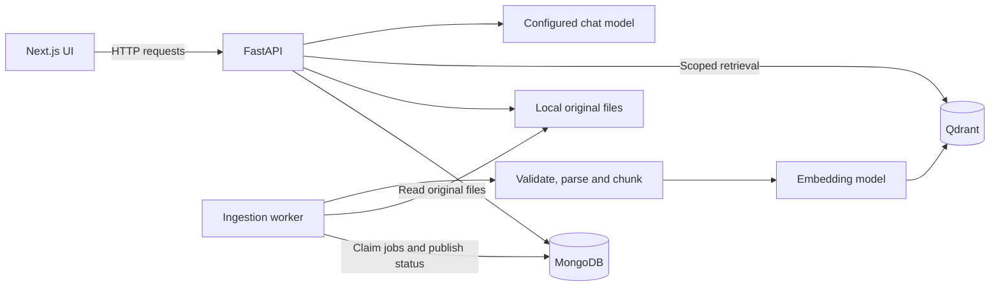

# AgenticRAG — Document Chatbot

AgenticRAG helps users understand documents and obtain evidence-based answers. Create a chat, upload several documents, and ask questions across all ready documents or a selected subset. Answers include source labels, supporting quotes and document locations.

This is a local development application. Chats persist, but the backend currently uses one shared development identity. User sign-in and authenticated multi-user access are not implemented.

## What the application supports

- Multiple chats with persisted messages and document attachments.
- Uploading PDF, DOCX, TXT, Markdown (`.md`) and CSV files; adding more documents later.
- Background document validation, parsing, chunking, embedding and indexing.
- Processing status, per-file failures and retries for retryable jobs.
- Questions across all ready documents or explicitly selected documents.
- A comparison mode that reserves evidence capacity for each scoped document.
- Citations identifying the document, supporting quote, and page or section.
- Original-file downloads from the document panel and citations.
- Removing a document from a chat while retaining historical citations and originals.
- Configurable OpenAI, Azure OpenAI or Cohere answer generation, independent of the embedding provider.
- Rotating structured operational logs and optional evaluation captures.

Documents need extractable text. Scanned/image-only documents require OCR before upload; the app does not perform OCR. It does not provide image understanding or token-streamed answers in the current UI.

## How it works



**Ingestion:** upload → save original and queue job → worker validates/parses → recursive text splitting → embeddings → Qdrant → document marked ready.

**Question answering:** freeze the selected document/index scope → retrieve passages within that scope → assemble evidence and scoped conversation history → generate an answer → validate citation labels and quotes → persist the result → display it in Next.js. The agent can refine retrieval within the same scope and evidence budget.

| Component | Responsibility | Default local address |
| --- | --- | --- |
| Next.js | Upload controls, chat navigation, document selection and answer display | `http://localhost:3000` |
| FastAPI | Application services, access checks, document/chat APIs and QA | `http://127.0.0.1:8000` |
| Ingestion worker | Background parsing, embeddings, indexing and job recovery | Separate Python process |
| MongoDB | Chats, messages, document metadata, attachments and jobs | `mongodb://127.0.0.1:27017` |
| Qdrant | Passage vectors and searchable metadata | `http://localhost:6333` |
| Local storage | Uploaded original documents | `var/uploads/` |

The UI does not connect directly to databases or model providers. The API and worker must share the same configuration, MongoDB database and upload directory.

## Prerequisites

- Python **3.11** for the API and worker.
- Node.js **22 or later** with npm for Next.js.
- Docker Desktop running, with Docker Compose available, or separately running compatible MongoDB and Qdrant services.
- Credentials for one supported chat provider and access to a chat model supporting tool calling.
- Internet access for dependency installation, provider requests and the first Hugging Face model download when uncached.

The commands below target macOS/Linux and must be run from the project root. VS Code is an editor; it does not replace the Python environments or the running services.

## First-time setup

### 1. Open the project

```bash
cd /AI_Engineering/DocumentBot/AgenticRAG
python3.11 --version
docker compose version
```

If the project is elsewhere, substitute its actual path. Open that folder in VS Code and use its integrated terminals if preferred.

### 2. Install backend and frontend dependencies separately

```bash
# API and ingestion worker environment:
python3.11 -m venv .venv-api
.venv-api/bin/python -m pip install --upgrade pip
.venv-api/bin/python -m pip install -r requirements-backend.txt

```

Install the frontend dependencies from the project root.

```bash
cd frontend
npx --yes pnpm@11.25.0 install --frozen-lockfile
cd ..
```

The backend requirements include the provider, parsing, and embedding stack. See the [frontend setup guide](frontend/README.md) for Node.js and API configuration.


### 3. Configure `.env`

If `.env` does not exist, create it from the template:

```bash
cp -n .env.example .env
```

Edit the existing `.env` rather than replacing your saved credentials. For public OpenAI answers with local Hugging Face embeddings, configure:

```dotenv
LLM_PROVIDER=openai
OPENAI_API_KEY=YOUR_OPENAI_API_KEY
OPENAI_MODEL=gpt-4.1-mini

API_EMBEDDING_PROVIDER=huggingface
API_EMBEDDING_MODEL=sentence-transformers/all-mpnet-base-v2
API_QDRANT_COLLECTION_PREFIX=agentic-rag-api
QDRANT_URL=http://localhost:6333
QDRANT_API_KEY=

MONGODB_URI=mongodb://127.0.0.1:27017
MONGODB_DATABASE=agentic_rag
UPLOAD_DIR=var/uploads
APP_ENV=development
```

Choose a tool-capable model available to your provider account. The shown model name is the repository default. The Hugging Face embedding model runs locally and may download weights on first use; the selected chat provider receives retrieved evidence for answer generation.

Alternatively, configure **Azure OpenAI** for answers:

```dotenv
LLM_PROVIDER=azure_openai
AZURE_OPENAI_API_KEY=YOUR_AZURE_RESOURCE_KEY
AZURE_OPENAI_ENDPOINT=https://YOUR_RESOURCE.openai.azure.com/
AZURE_OPENAI_DEPLOYMENT=YOUR_CHAT_DEPLOYMENT_NAME
AZURE_OPENAI_API_VERSION=YOUR_SUPPORTED_API_VERSION
```

Use the resource root endpoint, your Azure deployment name and an API version supported by that resource. The Azure key is separate from the public `OPENAI_API_KEY`.

For **Cohere** answers, set `LLM_PROVIDER=cohere`, `COHERE_API_KEY` and `COHERE_MODEL`. To use Cohere embeddings independently of the chat provider, set `API_EMBEDDING_PROVIDER=cohere`, `API_EMBEDDING_MODEL=embed-v4.0` and `COHERE_API_KEY`.

The backend uses `API_QDRANT_COLLECTION_PREFIX` plus an embedding-profile hash for its collections. `QDRANT_COLLECTION_NAME` in the template belongs to the older direct path and does not choose the current backend collection. Changing embedding settings does not automatically migrate existing documents: keep the API/worker settings aligned and upload documents under the intended profile.

The API and worker load the project-root `.env`. Restart them after changing backend settings. To point Next.js at a different API address, set `NEXT_PUBLIC_API_BASE_URL` in `frontend/.env.local` and restart Next.js. Configure `FRONTEND_ORIGINS` on FastAPI when using a different frontend origin.

### 4. Start the databases

**Fresh setup without an existing Qdrant service:**

```bash
docker compose up -d mongodb qdrant
docker compose ps
```

**If you already have a Qdrant container with your data:** start that existing container and keep `QDRANT_URL` pointed at it. Start only MongoDB from this Compose project:

```bash
docker compose up -d mongodb
```

Do not launch a second Qdrant service on the same port. An image listed in Docker Desktop is not enough: its container must be running. The checked-in Compose file defines its own Qdrant image and volume; reusing your current container avoids switching to a different data volume unintentionally.

Confirm Qdrant responds:

```bash
curl --fail http://localhost:6333/
```

The Qdrant dashboard is at **http://localhost:6333/dashboard**. Compose-managed databases retain data in named volumes across ordinary restarts. Keep any existing database/client versions unless you deliberately plan a separate compatibility change.

## Database migrations

The MongoDB migration tool tracks schema and data changes per database. See the [migration setup and commands](migrations/README.md) for checking status and applying pending scripts. The [multi-chat implementation plan](docs/multi-chat-plan.md) covers rename, archive, restore, and document reuse.

## Run the application

Open **three terminals**, each in the project root. Start the API first, then the worker and UI.

**Terminal 1 — FastAPI**

```bash
.venv-api/bin/python -m uvicorn src.api.main:app --host 127.0.0.1 --port 8000
```

**Terminal 2 — ingestion worker**

```bash
.venv-api/bin/python -m src.workers.ingestion
```

**Terminal 3 — Next.js**

```bash
cd frontend
npx --yes pnpm@11.25.0 dev
```

Open **http://localhost:3000**. API documentation is at **http://127.0.0.1:8000/docs**.

The API does not launch the worker automatically. Uploads can be accepted while the worker is stopped, but they remain queued until a matching worker starts. Start with one worker locally.

For later runs, you only need to start Docker/the database containers and these three processes; dependency installation is a one-time setup unless requirements change. Stop the app processes with `Ctrl+C`. For Compose-managed databases, `docker compose stop` stops containers without deleting their volumes. Avoid `docker compose down -v` when you want to preserve data.

**Windows:** create the API environment with `py -3.11 -m venv .venv-api` and use `.venv-api\Scripts\python.exe` in the backend commands. Run the same frontend commands in PowerShell. The setup was verified on macOS.

## First conversation

1. Create a chat and give it a title.
2. Choose one or more documents, then click **Add selected files**. Merely selecting files does not upload them.
3. Wait for processing to finish. Status is polled every four seconds. Ready documents can be queried while another file is still processing or has failed.
4. Choose **All ready documents** or **Select documents** for the question.
5. Choose `general` or `comparison`, then set the maximum evidence passages. Comparison needs at least two ready documents and at least one evidence passage per document.
6. Ask a question. Expand citations to inspect quotes, document IDs and page/section locations. Use **Download source** to open the original separately.
7. Add more files later using the same upload button, or **Remove from chat** to exclude a document from subsequent questions.

Example questions: “Summarize the main findings with citations,” “How do the two reports differ?” or “According to the selected document, what evidence supports this conclusion?”

Use the sidebar to reopen saved conversations. The `/chats/CHAT_ID` URL restores a chat after reload. Removing an attachment excludes it from subsequent questions and preserves historical citations. An answer already in progress uses its frozen source snapshot.

Default upload limits are **10 files / 100 MiB per batch**, **50 MiB per file** and **100 attachments per chat**. `UPLOAD_MAX_FILES` and `UPLOAD_BATCH_BYTES` configure backend batch limits; the current UI enforces the default 10-file/100-MiB limits. Parsing failures are shown per file; retryable processing failures expose **Retry processing**.

## Verify startup and troubleshoot

```bash
curl --fail http://127.0.0.1:8000/health
curl --fail http://127.0.0.1:8000/health/ready
curl --fail http://localhost:6333/
```

`/health` checks the API response; `/health/ready` checks MongoDB connectivity. Neither proves the worker, Qdrant, model credentials or model downloads are working. A small text-document upload that reaches `ready`, followed by a cited answer, verifies the broader workflow.

| Symptom | What to check |
| --- | --- |
| `node` or `npm` is missing | Install Node.js 22 or later with npm, then reopen your terminal. |
| `No module named src` | Launch from the repository root using the commands above. Avoid running internal service modules as standalone files. |
| UI cannot reach API | Start FastAPI and verify `NEXT_PUBLIC_API_BASE_URL` and `/health`. Check the API terminal for startup errors. |
| API fails on MongoDB startup | Start MongoDB, verify `MONGODB_URI`, and inspect `docker compose logs --tail=100 mongodb` if Compose-managed. |
| Documents stay queued | Start the worker; check its logs and ensure it uses the same database, upload directory and embedding profile as the API. |
| Embedding is slow on first use | Hugging Face weights may be downloading. Check worker logs and network access before retrying. |
| Qdrant connection refused | Start its container, check port 6333 and `QDRANT_URL`; an installed image alone is insufficient. |
| Qdrant client/server compatibility warning | Compare installed client and running server versions. This warning is not a successful connection/write check; resolve compatibility deliberately rather than simply suppressing it. |
| Invalid PDF or no extractable text | Upload a valid text-based document; perform OCR separately for scanned PDFs. Permanent content failures require corrected input. |
| Upload or question timed out | Refresh documents/conversation first. The server may have saved the operation; the UI does not automatically replay uncertain mutations. |
| Missing provider key or deployment error | Check the selected provider's `.env` values and the API logs; restart API/worker after changes. |
| Citation validation error | Inspect the request ID and logs. OpenAI/Azure use JSON mode, and malformed answer formats receive one bounded repair attempt using the same evidence. Repaired output must still pass citation checks; invalid citations are not served as a successful answer. Restart FastAPI after pulling this fix. |
| Port already in use | Reuse or stop the existing service. If changing the API port, update `NEXT_PUBLIC_API_BASE_URL` and restart the UI. |

## Logging and stored data

| Location | Contents |
| --- | --- |
| MongoDB database selected by `MONGODB_DATABASE` | Chat history, document metadata, memberships and ingestion jobs |
| Qdrant collections prefixed by `API_QDRANT_COLLECTION_PREFIX` | Embedded passages and retrieval metadata |
| `UPLOAD_DIR` (default `var/uploads/`) | Uploaded original files |
| `logs/app.<PID>.jsonl` | Structured operational events at the configured level, including INFO/WARNING/ERROR |
| `logs/error.<PID>.jsonl` | ERROR events |
| `logs/rag_runs.<PID>.jsonl` | Full QA evaluation captures, only when enabled |

Operational logs rotate using `LOG_MAX_BYTES` (default 10 MiB) and `LOG_BACKUP_COUNT` (default 5). Each process has its own PID-suffixed files. UI requests carry a `client_request_id`, recorded by the API alongside its server request ID for correlation. Operational events avoid raw document text and answer content.

`EVALUATION_CAPTURE_ENABLED=false` is the default. Enabling it stores full questions, answers, history and retrieval evidence in evaluation captures; treat those files as document data. Chat messages and originals persist independently of this setting.

## Code map

| Path | Responsibility |
| --- | --- |
| `frontend/` | Next.js pages, document controls, question composer, and API client |
| `src/api/` | FastAPI routes, request/response contracts, settings and error handling |
| `src/services/` | Ingestion, QA, scope resolution, retrieval and citation validation |
| `src/workers/ingestion.py` | Durable background processing and retries |
| `src/models/` and `src/repositories/` | Persistent records and MongoDB access |
| `src/storage/` | Original-file storage |
| `src/llms/` | Shared LLM configuration, factory and provider wrappers |
| `src/observability/` | Logging, request context and evaluation captures |
| `src/document_validation.py` | Supported-input validation and parsing |
| `multidoc.md` | Detailed implementation plan and milestone history |

## Verification and current boundaries

The Next.js production build and local API workflow were verified with deterministic embeddings and an offline LLM. The workflow covers uploads, job outcomes, question submission, saved citations, downloads, and detachment.

Citation validation checks labels and quote provenance, not semantic correctness of every claim. Authenticated multi-user access, automatic physical data cleanup, OCR and token streaming remain outside the current implementation.

Milestone F was omitted at the user's request. Existing `src/test_llm.py` and `test_case/` assets have not been migrated to the new multi-document API. Evaluation captures remain available for future evaluation work; this README does not present the older DeepEval runner as a verified test for the current flow.
